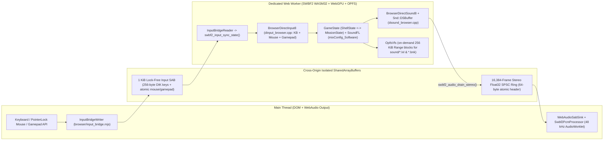

# Phase 5: Native Interactive Input (`SharedArrayBuffer` -> DirectInput8) & Real 3D `SoundFL` WebAudio Mixer

Status: **VERIFIED COMPLETE (`20 / 20` Phase 5 checks PASS, `29 / 29` Phase 4 checks PASS, `25 / 25` Phase 3 checks PASS, `audio_check.mjs` PASS, all 4 native-vs-WASM determinism oracles PASS).**

Phase 5 replaces the harness-only audio and input shims with SWBF2's real engine-native `SoundFL` 3D software mixer and full DOM -> `SharedArrayBuffer` -> `IDirectInput8A` input pipeline, and ships an interactive WebGPU + OPFS + WebAudio launcher at [browser/play.html](../browser/play.html).

---

## 1. Architecture Overview



---

## 2. Real Virtual-COM DirectSound8 & `SoundFL` 3D Software Mixer

### 2.1 Virtual COM Interfaces (`spike/shim/dsound.h`, `spike/shim/generated_types.h`, `tools/shim_autogen.py`)
Previously, `IDirectSound*` interfaces were non-virtual placeholder templates generated by `tools/shim_autogen.py`, and `DirectSoundCreate8` returned `DSERR_NODRIVER`, shutting down `Snd::Engine` completely (`g_bNoSound = true`).

All 12 DirectSound interfaces (`IDirectSound`, `IDirectSound8`, `IDirectSoundBuffer`, `IDirectSoundBuffer8`, `IDirectSound3DListener`, `IDirectSound3DBuffer`, `IDirectSoundNotify`, `IDirectSoundCapture*`, `IDirectSoundFXI3DL2Reverb8`) were promoted to real virtual COM interfaces in [spike/shim/dsound.h](../spike/shim/dsound.h) and removed from `IFACES` in [tools/shim_autogen.py](../tools/shim_autogen.py) so regeneration preserves them cleanly. All `771 / 771` core TUs compile cleanly against the new virtual vtables on both `wasm32` (`build/core.a`) and native ILP32 (`build/native_core.a`).

### 2.2 Software DirectSound8 & `Snd::DSBuffer` Backend ([browser/platform/dsound_browser.cpp](../browser/platform/dsound_browser.cpp))
- **Native `SoundFL` `mixConfig_Software` path:** `BrowserDirectSound8::GetCaps()` advertises stereo 16-bit software mixing (`dwMaxHwMixingAllBuffers = 0`, `DSSPEAKER_STEREO`), causing `Snd::Engine::Open()` to run SWBF2's own 32-voice 3D software mixer (`Snd::SoftOutput` + `Snd::Voice` + `Snd::Source3D` distance attenuation, Doppler pitch, and stereo panning) alongside all 6 streaming IMA-ADPCM/PCM music & VO channels (`Snd::Stream` + `Snd::StreamIMAADPCMDecoder`), streaming retail `sound/shell.lvl`, `sound/common.bnk`, `sound/tat.lvl`, and `sound/spa.lvl` directly on-demand from OPFS via [browser/platform/sndfile_browser.cpp](../browser/platform/sndfile_browser.cpp).
- **Circular `BrowserDSBuffer` + Synchronous Pump:** All COM objects and circular PCM buffers are allocated via `malloc`/`free` (outside `GameMemory::RunTimeHeap`). Because single-threaded WASM has no Win32 `Snd::ThreadUpdate` background thread, `swbf2_audio_pump_and_mix(dt)` walks `Snd::Engine::GetThreadUpdate()->mUpdateList` and calls `UpdateObject()` on every active `DSBufferRenderer` before and after mixing every playing `BrowserDSBuffer` (with linear resampling, volume, stereo pan, and 3D azimuth panning) into a 16,384-frame 48 kHz stereo float32 ring buffer.
- **Exports:** `swbf2_audio_set_enabled`, `swbf2_audio_pump_and_mix`, `swbf2_audio_drain_stereo`, `swbf2_audio_mix_pending_frames`, `swbf2_audio_reset_stats`, `swbf2_audio_stats`.

### 2.3 Lock-Free `SharedArrayBuffer` AudioWorklet ([browser/webaudio-worklet.mjs](../browser/webaudio-worklet.mjs), [browser/webaudio.mjs](../browser/webaudio.mjs))
- `Swbf2PcmProcessor` now supports `{ type: 'init-sab', sab, capacityFrames }` (64-byte atomic Int32 header `[writeIdx, readIdx, underruns, totalFramesRead, muted]` + stereo `Float32Array` channels, zero heap allocations inside `process()`) while retaining the legacy `{ type: 'pcm' }` path so [browser/audio_check.mjs](../browser/audio_check.mjs) remains green.
- `WebAudioSabSink` owns the 48 kHz `AudioContext` + `AudioWorkletNode` on the main thread; `AudioRingWriter` drains `swbf2_audio_drain_stereo()` inside [browser/worker.mjs](../browser/worker.mjs) every frame with `Atomics.store`.

---

## 3. Lock-Free `SharedArrayBuffer` DOM Input -> DirectInput8

- **[browser/input_bridge.mjs](../browser/input_bridge.mjs):**
  - Complete W3C `KeyboardEvent.code` -> Microsoft `DIK_*` scancode table (`0x01..0xED`).
  - 1 KiB `SharedArrayBuffer`: 256-byte DirectInput key matrix (`0x80` down / `0x00` up) + atomic mouse deltas (`dx, dy, dz`), viewport-scaled absolute menu cursor (`cursorX, cursorY, useAbs`), mouse buttons, Gamepad API (`navigator.getGamepads()`) 6 axes + 32 buttons + D-pad POV, and a worker-written `pointerLockWanted` flag (`state === 'mission' && playerAlive && !spawnVisible && currentScreen === ''`).
  - `InputBridgeWriter` (main thread) attaches DOM keyboard/mouse/wheel/PointerLock listeners and `rAF` gamepad polling; clicking the canvas automatically requests PointerLock during live 3D gameplay and uses absolute cursor coordinates in `ShellState`, Pause, and Spawn menus.
  - `InputBridgeReader` (worker) atomically exchanges `(dx, dy, dz)` once per frame and syncs all input in a single C ABI call (`swbf2_input_sync_state`).
- **[browser/platform/dinput_browser.cpp](../browser/platform/dinput_browser.cpp):**
  - Extended `BrowserDirectInput8::EnumDevices` to advertise a virtual `DI8DEVCLASS_GAMECTRL` (`GUID_Joystick`) device alongside keyboard and mouse (`diDevices = 3`), serving `DIJOYSTATE2` in `GetDeviceState`.
- **[browser/play.html](../browser/play.html) + [browser/play.mjs](../browser/play.mjs):**
  - Full-viewport start-gated WebGPU + OPFS + `SharedArrayBuffer` Input + 48 kHz WebAudio launcher (also linked from [browser/index.html](../browser/index.html)).

---

## 4. Verification Results

Verified in Headless Chrome + Hardware NVIDIA Pascal Vulkan (`--autoplay-policy=no-user-gesture-required`) via [browser/phase5_input_audio_check.mjs](../browser/phase5_input_audio_check.mjs):

| Metric | Measured Value |
|---|---|
| Phase 5 Suite (`browser/phase5_input_audio_check.mjs`) | **20 / 20 PASS** |
| `SoundFL` Mix Mode | `mixConfig = 1` (`mixConfig_Software`, 48 kHz stereo) |
| Shell Audio (`sound/shell.lvl` + `sound/common.bnk` streamed via OPFS) | `totalBuffersCreated = 3`, `peakPlayingBuffers = 2`, `nonZeroFrames = 15,315`, `maxPeak = 0.0688`, `overallRms = 0.0059 / 0.0059`, `AudioWorklet` drained `57,520` frames (`underruns = 3`, `overruns = 0`), WebAudio `AnalyserNode` `peak = 0.0688` |
| DOM `KeyboardEvent('Enter')` -> SAB -> `IDirectInput8A` Login | `ifs_login` -> `ifs_sp_campaign` naturally |
| DOM `MouseEvent` Canvas Clicks -> SAB -> `IDirectInput8A` Spawn (`tat2g_con`) | Team 1 + SPAWN -> `playerAlive = true`, `pointerLockWanted = true` |
| DOM `KeyboardEvent('KeyW')` (750 ms) | Player physically moved **`5.272 m`** |
| DOM `MouseEvent('mousemove', { movementX })` (PointerLock) | Player rotated **`96.74°`** |
| DOM `MouseEvent('mousedown', { button: 0 })` | Blaster weapon fired (`fired = true`, ammo decremented) |
| Live 3D Mission Audio (`tat2g_con`, `sound/tat.lvl` + combat SFX) | `overallRmsL = 0.0121`, `overallRmsR = 0.0160` (asymmetric 3D stereo panning), `maxPeak = 0.1077`, `stereoMeanDiff = 0.004221`, `AudioWorklet` drained `294,268` frames, `AnalyserNode` `peak = 0.1056` (`92,703` non-zero samples) |
| Live Gameplay Frame Readback (`phase5_tat2_live.png`) | `930` draws, `130,524` tris, `12` skinned draws / `12,300` skinned tris, `99.79%` non-black, `0` WebGPU errors |
| Teardown & Round-Trip | Clean return to `ShellState` (`ifs_sp_campaign`), `0` WebGPU errors |

### Reproduction Commands

```sh
./tools/compile_core.sh
./tools/build_browser.sh
vendor/emsdk/node/24.19.0_64bit/bin/node browser/phase5_input_audio_check.mjs
```

To play interactively in a local browser:

```sh
python3 tools/serve.py 8123
# Open http://127.0.0.1:8123/browser/play.html
```
