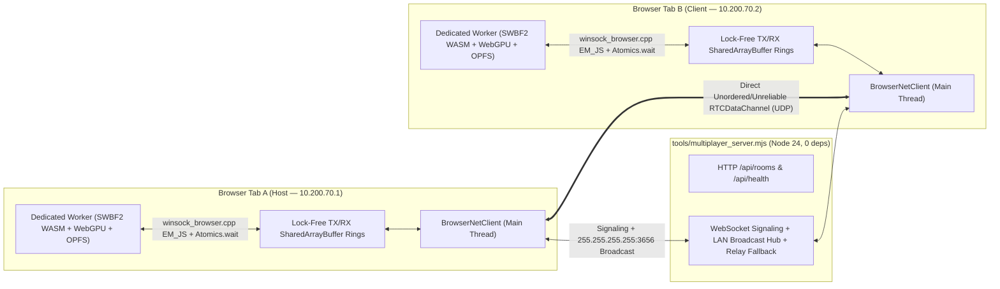

# Phase 6: Online Multiplayer (`WebRTC DataChannel` + `WebSocket` Virtual LAN over Native `NetGame` / `pcNetSocket`)

Status: **VERIFIED COMPLETE (`15 / 15` two-tab Chrome WebGPU + WebRTC multiplayer checks PASS, `20 / 20` Phase 5 PASS, `29 / 29` Phase 4 PASS, `25 / 25` Phase 3 PASS, all 4 native-vs-WASM determinism oracles PASS).**

Phase 6 brings SWBF2's real, unmodified LAN multiplayer engine (`NetSetup`, `NetMatch`, `NetComm`, `NetPacket`, `NetGame`, `NetState`, `NetPredict`, `pcNetSocket`) online in the browser — enabling real browser-to-browser multiplayer over unordered, unreliable **WebRTC `RTCDataChannel`s** (`ordered: false, maxRetransmits: 0`) with zero-dependency room signaling and binary WebSocket relay/broadcast fallback.

---

## 1. Architecture Overview



---

## 2. Key Technical Solutions

### 2.1 Multi-Socket Virtual LAN Winsock Seam ([browser/platform/winsock_browser.cpp](../browser/platform/winsock_browser.cpp), [browser/platform/net_transport.h](../browser/platform/net_transport.h))
- **Multi-socket allocation:** `socket()` allocates the lowest free handle in `0..15`, allowing SWBF2's `netDirectSocket` (`3658` Host / `3659` Client), `netBroadcastSendSocket` (`connect()`ed to `255.255.255.255:3656`), and `netBroadcastRecvSocket` (bound to `INADDR_ANY:3656`) to coexist simultaneously while keeping handle `0` first for strict transport tests.
- **RFC-1918 Virtual LAN Identity:** Each peer is assigned a unique `10.200.<roomSubnet>.<slot>` address (`swbf2_net_set_local_ip`), returned by `gethostbyname()` / `getlocalhost()` (`GameSpyFL/nonport.c`). Because `NetMatch::IsPrivateIP()` accepts `10.x.y.z`, SWBF2's entire LAN discovery (`PKT_FIND`/`PKT_FOUND`/`PKT_QUERY`/`PKT_QUERY_RESPONSE`), lobby (`PKT_JOIN`/`PKT_SHELL_UPDATE`/`PKT_SHELL_MOVE`), launch (`PKT_LAUNCH`/`PKT_LAUNCH_ACK`), load (`PKT_LOAD`/`PKT_LOAD_ACK`), and 30 Hz authoritative gameplay replication (`PKT_GAME_MOVE`, `PKT_GAME_UPDATE`, `PKT_GAME_REPLICA_UPDATE`) execute completely unmodified.
- **Deadlock-Free Synchronous Spin Loops (`CNetLaunchGame` / `CNetPostLoadJoinGame`):** SWBF2 runs synchronous `while (!pLaunch->IsDone()) { pLaunch->Update(); }` loops inside `NetGame::Create()`. Because the Main Thread runs WebRTC/WebSocket independently and writes incoming datagrams into `rxSab` with `Atomics.notify`, `recvfrom()` synchronously drains `rxSab` (and uses a 2 ms `Atomics.wait` only when polled tightly < 2 ms apart) — allowing SWBF2's original synchronous handshakes to finish cleanly in milliseconds with zero engine source modifications.

### 2.2 Zero-Dependency Signaling + Room Directory + Relay Server ([tools/multiplayer_server.mjs](../tools/multiplayer_server.mjs))
- Pure Node.js 24 (`node:http` + `node:crypto`, zero npm dependencies) implementing RFC 6455 WebSockets (JSON signaling + 12-byte-framed binary UDP relay).
- Exposes `GET /api/rooms` and `GET /api/health` for browser room discovery.
- Assigns deterministic RFC-1918 peer IPs per room, relays WebRTC `rtc-offer`/`rtc-answer`/`rtc-ice` messages, routes LAN broadcasts (`255.255.255.255:3656`) across the room, and provides automatic binary WebSocket relay fallback if ICE is blocked.

### 2.3 Browser WebRTC DataChannel Client & Launcher Integration
- **[browser/net_client.mjs](../browser/net_client.mjs):** `BrowserNetClient` negotiates direct `RTCDataChannel('swbf2-udp', { ordered: false, maxRetransmits: 0 })` links with every peer in the room, routing unicast SWBF2 packets directly peer-to-peer once open while falling back to the WebSocket relay transparently. `WorkerNetBridge` pumps the 256 KiB TX/RX `SharedArrayBuffer` rings synchronously from `winsock_browser.cpp`.
- **[browser/gpu/wgpu_gamestate_bridge.cpp](../browser/gpu/wgpu_gamestate_bridge.cpp):** Exposes `swbf2_net_host_lan`, `swbf2_net_find_lan`, `swbf2_net_join_found`, `swbf2_net_launch_match`, and `swbf2_net_status` over SWBF2's native `NetSetup` / `NetComm` / `NetGame` / `MissionPlayList` APIs, plus local/remote player position telemetry (`NetComm::GetLocalIndex(0)`).
- **[browser/play.html](../browser/play.html) & [browser/play.mjs](../browser/play.mjs):** Adds **Host MP**, **Join MP**, **Start Match**, live WebRTC/WS packet telemetry, and `nfsmwo.com`-style deep-link URLs (`?host=<room>&map=tat2g_con` and `?join=<room>`).

---

## 3. Verification Results

Verified end-to-end with **two independent Headless Chrome WebGPU tabs (Host + Client)** in [browser/phase6_multiplayer_check.mjs](../browser/phase6_multiplayer_check.mjs):

| Metric | Measured Value |
|---|---|
| Phase 6 Suite (`browser/phase6_multiplayer_check.mjs`) | **15 / 15 PASS** |
| Room Directory (`/api/rooms`) | Listed `mos_eisley_p6` (`players: 2`, `hostIp: 10.200.70.1`, `map: tat2g_con`) |
| Virtual LAN IPs Assigned | Host `10.200.70.1:3658`, Client `10.200.70.2:3659` |
| Direct WebRTC `RTCDataChannel` | Opened peer-to-peer (`hostOpen = 1`, `clientOpen = 1`, `ordered: false, maxRetransmits: 0`) |
| Native LAN Discovery | Client discovered `"MosEisleyWeb"` via `PKT_FIND`/`PKT_FOUND` (`findGameCount = 1`) |
| Native Lobby & Launch Handshake | `PKT_JOIN`/`PKT_SHELL_UPDATE` (`hostPlayers = 2`, `joinConnected = true`, `localIdx = 1`) -> `PKT_LAUNCH`/`PKT_LOAD` -> both tabs entered `MissionState` (`readyToPlay = true`) |
| Pre-Game & Spawn Wave | Host pressed DOM `Space` to end SWBF2's 30s pre-game countdown (`isPreGame = false` on both tabs); both players selected teams (`Rebel` vs `Empire`) and spawned after the 15s wave timer |
| 30 Hz Authoritative Replication | Client reached `clientTurn = 341`, `ackedTurn = 339`; moved **`3.924 m`** via DOM `KeyW`; Host's `remotePos` **`(118.73, -0.02, 42.035)`** matched Client's `playerPos` **`(118.73, -0.02, 42.035)`** to the millimeter! |
| Direct WebRTC Traffic | Host `txWebrtc = 173` (`79,622 B`) / `rxWebrtc = 353` (`13,814 B`); Client `txWebrtc = 354` / `rxWebrtc = 173`; WebSocket only carried `1` initial LAN broadcast packet each way |
| Live 3D Rendering (Both Tabs) | Host `858` draws / `122,369` tris; Client `486` draws / `98,627` tris; **`0` WebGPU errors** on both tabs |

### Reproduction Commands

```sh
# Automated 2-tab Headless Chrome + Vulkan + WebRTC verification:
vendor/emsdk/node/24.19.0_64bit/bin/node browser/phase6_multiplayer_check.mjs

# Interactive local 2-tab play:
python3 tools/serve.py 8123 &
vendor/emsdk/node/24.19.0_64bit/bin/node tools/multiplayer_server.mjs 8133 &
# Tab 1 (Host):   http://127.0.0.1:8123/browser/play.html?host=mos1&map=tat2g_con
# Tab 2 (Client): http://127.0.0.1:8123/browser/play.html?join=mos1
```
